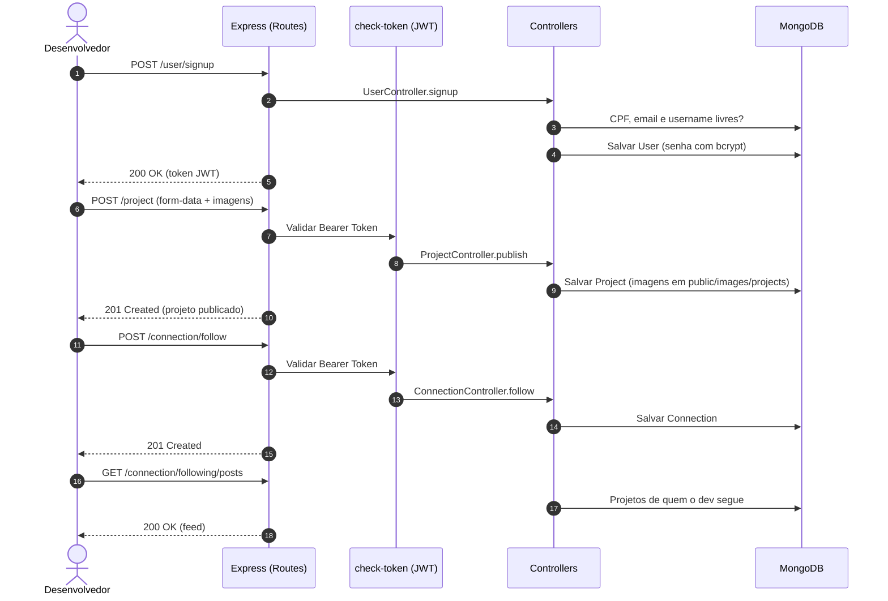

# 🌴 DevParadise API — Rede de Portfólios para Devs Iniciantes


> Perfis, projetos e conexões para que desenvolvedores iniciantes mostrem seu trabalho e façam networking.

A **DevParadise API** é a API RESTful do TCC do curso técnico de Desenvolvimento de Sistemas da **ETEC Professor Camargo Aranha**. Desenvolvida em **Node.js** com **Express** e **MongoDB**, ela sustenta o [DevParadise](https://github.com/matheusnascimentods/devparadise-app), uma plataforma que conecta desenvolvedores iniciantes ao mercado de trabalho: cada dev cria um perfil, publica projetos com imagens, segue outros devs e acompanha o que eles publicam. A autenticação é feita com **JWT** e as senhas são armazenadas com **bcrypt**.



---

## ✨ O Problema
Desenvolvedores iniciantes têm dificuldade para entrar no mercado:
- **Pouca visibilidade**: Projetos ficam espalhados em repositórios sem contexto.
- **Falta de networking**: Não há um espaço focado em quem está começando.
- **Portfólio difícil de montar**: Criar e manter um site próprio exige tempo e conhecimento.

---

## 🚀 A Solução
- **Perfis de desenvolvedor**: Nome, descrição, habilidades, GitHub, LinkedIn e foto.
- **Publicação de projetos**: Título, descrição, tecnologias, repositório, link e imagens, com destaque para os favoritos.
- **Conexões**: Seguir e deixar de seguir devs, ver seguidores e seguidos.
- **Feed**: Projetos publicados por quem o dev segue.
- **Busca**: Pesquisa de usuários e projetos por texto.

---

## 🎯 Diferenciais
- **Login flexível**: O dev entra com username **ou** email.
- **Upload de imagens**: Multer grava as imagens em `public/images`, servidas estaticamente pela própria API.
- **Validação de entrada**: `express-validator` nas rotas de cadastro, login, troca de senha e follow.
- **Exclusão segura**: Excluir a conta exige a senha atual.

---

## 🛠️ Stack Tecnológica

| Camada | Tecnologia |
|---|---|
| **Runtime** | Node.js 20+ (LTS) |
| **Framework** | Express 4 |
| **Banco de Dados** | MongoDB com Mongoose 8 |
| **Autenticação** | JSON Web Token (`jsonwebtoken`) |
| **Hash de Senhas** | bcrypt |
| **Upload de Arquivos** | Multer |
| **Validação** | express-validator, email-validator |
| **Dev Server** | nodemon |

---

## 🏛️ Arquitetura

```
routes        ← Definição das rotas, validação e middlewares (token, id, upload)
   ↓
controllers   ← Regras de negócio (UserController, ProjectController, ConnectionController)
   ↓
models        ← Schemas Mongoose (User, Project, Connection)
   ↓
database      ← Conexão com o MongoDB
```

`helpers/` concentra os middlewares e utilitários compartilhados: geração e verificação de token, busca do usuário pelo token, validação de body e id, upload de imagens e contagem de conexões.

### Principais Entidades
- **`User`**: Nome, username, email, CPF, descrição, skills, GitHub, LinkedIn, imagem e senha (hash).
- **`Project`**: Título, descrição, tecnologias, repositório, link, imagens, autor (`devId`/`devUsername`) e flag `favorite`.
- **`Connection`**: Relação `followerId` → `followedId` entre dois usuários.

---

## 📁 Estrutura do Projeto

```text
devparadise-api/
├── index.js                     # Bootstrap do Express, CORS, estáticos e rotas
├── controllers/                 # Regras de negócio
├── database/connection.js       # Conexão Mongoose
├── helpers/                     # Middlewares e utilitários
├── models/                      # Schemas Mongoose
├── public/images/               # Imagens enviadas (users/ e projects/)
├── routes/                      # Rotas de user, project e connection
└── package.json
```

---

## ⚡ Quick Start

### Pré-requisitos
- [Node.js 20+](https://nodejs.org/) instalado
- Uma instância do [MongoDB](https://www.mongodb.com/) (local ou Atlas)

### 1. Clonar o repositório
```bash
git clone https://github.com/matheusnascimentods/devparadise-api.git
cd devparadise-api
```

### 2. Instalar as dependências
```bash
npm install
```

### 3. Configurar o ambiente
Crie um arquivo `.env` na raiz do projeto:
```env
API_PORT=3000
MONGO_URI=mongodb://localhost:27017/devparadise
FRONT_URL=http://localhost:5173
```

### 4. Executar a Aplicação
```bash
npm run dev
```

A API estará disponível em: **`http://localhost:3000`**

---

## 💻 Comandos Úteis de Desenvolvimento

```bash
# Rodar em modo de desenvolvimento (reinicia a cada alteração)
npm run dev

# Rodar em modo normal
npm start
```

---

## 🔌 API Reference

Rotas marcadas com 🔒 exigem o header `Authorization: Bearer <token>`.

### 👤 Usuários (`/user`)
| Método | Rota | Descrição | Acesso |
| :--- | :--- | :--- | :--- |
| `POST` | `/user/signup` | Cria um usuário e devolve o token | Público |
| `POST` | `/user/login` | Login com `login` (username ou email) e `password` | Público |
| `GET` | `/user` | Lista usuários; aceita `?q=` (busca), `?username=` ou `?id=` | Público |
| `GET` | `/user/me` | Dados, projetos e conexões do usuário autenticado | 🔒 |
| `PATCH` | `/user` | Edita o perfil (form-data, campo `image` para a foto) | 🔒 |
| `PATCH` | `/user/change-password` | Troca a senha (`password`, `newPassword`, `confirmPassword`) | 🔒 |
| `DELETE` | `/user` | Exclui a conta (exige `password` no corpo) | 🔒 |

Corpo de `POST /user/signup`:
```json
{
  "name": "Ada Lovelace",
  "username": "adalovelace",
  "email": "ada@example.com",
  "cpf": "12345678901",
  "phone": "11999999999",
  "description": "Dev front-end em formação",
  "skils": ["JavaScript", "React"],
  "password": "123456"
}
```
`username` precisa de pelo menos 5 caracteres, `cpf` de 11 e `password` de 6. CPF, email e username devem ser únicos.

### 🗂️ Projetos (`/project`)
| Método | Rota | Descrição | Acesso |
| :--- | :--- | :--- | :--- |
| `POST` | `/project` | Publica um projeto (form-data, campo `images` para as imagens) | 🔒 |
| `GET` | `/project` | Lista projetos; aceita `?q=`, `?id=` ou `?author=` | Público |
| `GET` | `/project/me` | Projetos do usuário autenticado | 🔒 |
| `PATCH` | `/project/favorite` | Marca/desmarca um projeto como favorito (`id` no corpo) | 🔒 |
| `PATCH` | `/project/:id` | Edita um projeto (form-data) | 🔒 |
| `DELETE` | `/project/:id` | Exclui um projeto | 🔒 |

Campos de `POST` e `PATCH /project/:id`:

| Campo | Tipo | Obrigatório |
| :--- | :--- | :--- |
| `title` | String | Sim |
| `description` | String | Sim |
| `technologies` | Array | Sim |
| `repository` | String (URL) | Não |
| `link` | String (URL) | Não |
| `images` | Arquivos PNG/JPG/JPEG/JFIF | Não |

### 🔗 Conexões (`/connection`)
| Método | Rota | Descrição | Acesso |
| :--- | :--- | :--- | :--- |
| `POST` | `/connection/follow` | Segue um usuário (`followedId` no corpo) | 🔒 |
| `DELETE` | `/connection/unfollow` | Deixa de seguir um usuário (`followedId` no corpo) | 🔒 |
| `GET` | `/connection/:username/status` | Indica se o usuário autenticado segue `:username` | 🔒 |
| `GET` | `/connection/:username/followers` | Seguidores de `:username` (aceita `?q=`) | Público |
| `GET` | `/connection/:username/following` | Quem `:username` segue (aceita `?q=`) | Público |
| `GET` | `/connection/following/posts` | Feed com os projetos de quem o usuário autenticado segue | 🔒 |

### 🖼️ Arquivos estáticos
As imagens enviadas ficam acessíveis em `/public/images/users/<arquivo>` e `/public/images/projects/<arquivo>`.

---

## 🗂️ Variáveis de Ambiente & Configuração

| Variável de Ambiente | Descrição | Exemplo (Local) |
| :--- | :--- | :--- |
| `API_PORT` | Porta de execução da API | `3000` |
| `MONGO_URI` | URI de conexão com o MongoDB | `mongodb://localhost:27017/devparadise` |
| `FRONT_URL` | Origem permitida pelo CORS (frontend) | `http://localhost:5173` |

O arquivo `.env` não é versionado; cada ambiente deve fornecer os próprios valores.

---

## 🔒 Segurança & Boas Práticas

- **Autenticação Stateless**: Tokens JWT carregando `name` e `id` do usuário.
- **Senhas com hash**: Armazenadas com bcrypt; a troca e a exclusão de conta exigem a senha atual.
- **CORS restrito**: Apenas a origem definida em `FRONT_URL` é aceita.
- **Upload filtrado**: Só são aceitas imagens PNG, JPG, JPEG e JFIF.
- **Ponto de atenção**: O segredo de assinatura do JWT está fixo no código (`helpers/create-user-token.js` e `helpers/check-token.js`). Antes de qualquer deploy, mova-o para uma variável de ambiente.

---

## 🤝 Contribuindo

1. Faça um Fork do projeto
2. Crie uma branch para a sua funcionalidade (`git checkout -b feature/nome-da-feature`)
3. Faça o commit das suas alterações (`git commit -m 'feat: implementa nova funcionalidade'`)
4. Envie para o repositório remoto (`git push origin feature/nome-da-feature`)
5. Abra um **Pull Request** detalhando as alterações

---

## 📄 Licença

Distribuído sob a licença MIT. Veja [`LICENSE.txt`](LICENSE.txt) para mais detalhes.

---
Feito com ❤️ por [@matheusnascimentods](https://github.com/matheusnascimentods)
